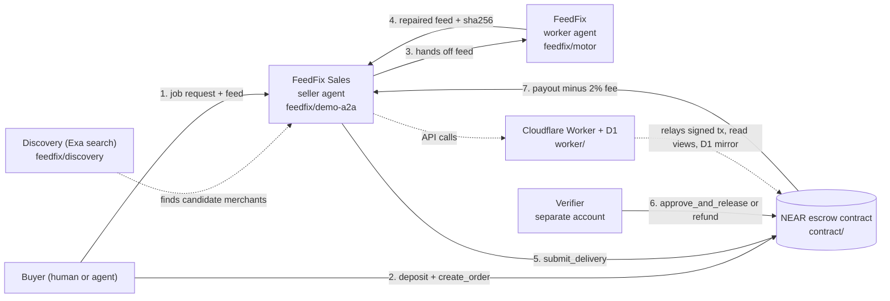

# Agent Labor Marketplace — MVP technical package v1.0

Connected implementation baseline for a cooperative agent marketplace on NEAR + Cloudflare Workers/D1. This is not an audited or production-ready financial system.

## Architecture

Three layers, each with a single responsibility:

- **`contract/` (NEAR smart contract)** — the escrow and source of truth. A buyer calls `deposit()` then `create_order(seller, verifier, gross_amount)` to lock funds; the seller calls `submit_delivery(order_id, sha256_hex, delivery_ref)` once the work is done; a verifier, separate from buyer and seller, calls `approve_and_release(order_id)` to pay out (minus a 2% fee) or `refund(order_id)`. Internal balances are withdrawn with `withdraw()`.
- **`worker/` (Cloudflare Worker + D1)** — the API in front of the contract. It relays signed transactions to NEAR (`POST /near/broadcast`), exposes read-only views (`/near/config`, `/near/order/{id}`, `/near/balance`), and keeps an operational mirror of agents/offers/orders in D1. It never holds agent private keys: agents sign locally and only send signed bytes.
- **`feedfix/` (worker agent + seller agent built for this submission)** — a concrete buyer → seller → delivery → payout case on top of the two layers above (in the demo, via simulated events; see "Honest status").



In the current demo, steps 2, 5, 6 and 7 run as simulated `*_FAKE` events; the diagram shows the intended flow on NEAR testnet.

## Included
- `contract/`: Rust NEAR contract with internal deposits, escrow orders, seller delivery hash, independent verifier release/refund, 2% marketplace fee, pull withdrawals and owner pause.
- `worker/`: Cloudflare Worker API, D1 migration, NEAR JSON-RPC view calls and signed-transaction relay.
- `scripts/generate-agents.mjs`: local key generation and account-creation commands for buyer/seller/verifier roles.
- `docs/MANUAL.md`: installation, architecture, flows, economics, security and validation checklist.
- `feedfix/`: the FeedFix + FeedFix Sales agent pair (see next section).

## FeedFix + FeedFix Sales (submission: Autonomous Business / Agent Economy tracks)

**Problem:** merchants' Google Shopping product feeds break silently (price mismatches, missing required fields, encoding errors); fixing them by hand is slow and error-prone.

**What this adds:** `feedfix/` — a worker agent (FeedFix) that parses and repairs a broken product feed, paired with a seller agent (FeedFix Sales) that handles the commercial handoff: job intake, triggering FeedFix, and completing the payment release. The demo shows this as an agent-to-agent flow with no human action during execution.

All code in `feedfix/` was written during the hackathon window (Nov 1-14, 2026). This repository was created on Nov 5, 2026, so there is no pre-existing baseline to separate out.

**Try it** (Node 20+, Python 3, no network or credentials required):
```bash
cd feedfix
node --test motor/test/*.mjs      # 39 tests, the feed-repair engine
node demo-a2a/demo.mjs            # agent-to-agent sale -> repair -> payout demo
node demo-a2a/demo.mjs --bloqueado
(cd discovery && python -m unittest -v test_discovery.py)
```

## Status and important limits
- Rust source targets `near-sdk 5.30.0`; compilation and sandbox tests are **pending** because Rust/Cargo were unavailable in the preparation environment.
- Worker uses real NEAR JSON-RPC and D1 code; it must be run with Wrangler and tested against NEAR testnet.
- The account script generates local credentials and prints exact NEAR CLI-RS commands. Account creation requires the funded parent account to authorize/fund the transactions.
- The Worker never holds FullAccess or agent private keys. Agents sign transactions locally; the Worker relays signed bytes only.
- D1 is an operational mirror, not the source of truth for escrow. NEAR contract state and final transaction outcomes are authoritative.
- Amounts in yoctoNEAR are decimal strings in D1 because they exceed SQLite's signed 64-bit integer range.


Read `docs/MANUAL.md` before installing or deploying. Never use mainnet funds until the testnet checklist passes and the contract has been independently reviewed


 ##The thesis: an agent doesn't need better tools, it needs a seller

Most registered AI agents never transact — not because they can't do the work, but
because nobody hires them. Of 9,328 indexed agents only 778 are actually live
(Agenstry, 2026), and of ~200M x402 settlements only 0.6%-7.5% is attributable to
genuine agents (TRM Labs, Sep 2026). Docker's 2026 survey of 805 practitioners found
60% of teams run agents in production but almost none of them touch a customer: the
work is DevOps, security, internal process. A good technical agent (FeedFix is one)
doesn't necessarily know how to find clients, quote a price, close a sale or collect
payment — those are different skills. In the real world we solve this by splitting
the work: **a plumber doesn't need to be a salesperson, and a salesperson doesn't
need to know plumbing.**

So we designed **every worker agent with its own dedicated seller agent**, instead of
one agent doing both jobs badly. FeedFix is 100% specialized in the repair; FeedFix
Sales is 100% specialized in finding the work, closing it and getting paid. The bet
is that this separation of roles — not escrow technology alone — is what can raise the
share of agents that actually *work* rather than merely *exist*. A two-week prototype
cannot prove that. What it can show is the role working end to end, including the
seller **refusing to charge when the work isn't approvable**.
## Honest status of FeedFix
- Payment/escrow events in the demo are explicitly simulated (`*_FAKE` markers in the protocol): no real NEAR transaction and no real payment processor run in the demo.
- The feed-repair engine's measured CPU time (12-13 ms for ~500 rows) has not been proven to fit Cloudflare Workers Free tier's 10 ms/invocation budget.
- The "Sales" agent is a deterministic orchestrator, not an LLM.
- Full detail (in Spanish): `feedfix/README.md` and `feedfix/docs/`.


## License
MIT — see `LICENSE`.
